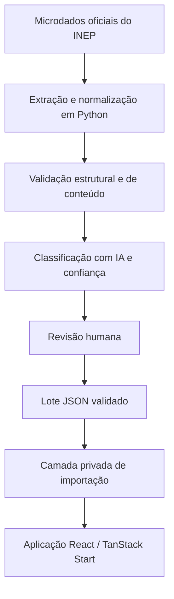

# Plataforma ENEM — portfólio técnico

Este repositório apresenta uma versão pública e sanitizada do trabalho técnico desenvolvido em uma plataforma de estudos e questões do ENEM. A aplicação comercial está no ar e possui usuários, mas seu código, seus dados operacionais e suas integrações permanecem privados.

> **Escopo deste repositório:** demonstrar a arquitetura e um pipeline reproduzível para extrair, normalizar, validar e preparar questões a partir dos microdados oficiais do INEP. Este não é o código-fonte da plataforma comercial.

## Status

- Plataforma comercial: **no ar**
- Repositório público: **demonstração técnica sanitizada**
- Site: [Conheça a Plataforma ENEM](https://pixel-perfect-clone-89498.lovable.app)
- Demonstração pública: [Abrir modelo interativo](https://quintas-borbas.github.io/plataforma-enem-portfolio/)

## Stack da plataforma

- Front-end: React, TypeScript e TanStack Start
- Back-end: Supabase/PostgreSQL
- Autenticação e autorização: autenticação com Row Level Security (RLS)
- Dados: microdados oficiais do INEP
- Pipeline: Python
- Classificação: IA com nota de confiança e revisão humana

## Arquitetura



O diagrama mostra o fluxo conceitual. A camada privada de importação, o banco de produção e a aplicação comercial não fazem parte deste repositório.

## Como o pipeline funciona

1. Lê o arquivo `ITENS_PROVA_<ANO>.csv` disponibilizado nos microdados do INEP.
2. Filtra as questões pela área e, opcionalmente, pelo código da prova.
3. Normaliza espaços, campos textuais, número da questão e alternativas.
4. Descarta ou direciona para revisão itens anulados, incompletos ou com gabarito inválido.
5. Valida identidade, campos obrigatórios, alternativas e duplicidades.
6. Gera um lote JSON portátil para revisão e importação posterior.
7. A classificação por IA recebe nota de confiança; casos incertos passam por revisão humana antes da importação.

O código público não contém prompts, credenciais, taxonomia proprietária, dados classificados nem conexão com a infraestrutura de produção.

## Decisões técnicas

- **Fonte oficial:** o pipeline parte dos microdados do INEP para preservar rastreabilidade.
- **Validação antes da escrita:** itens inválidos são separados antes de qualquer importação.
- **Lotes JSON:** tornam a revisão auditável e desacoplam extração, classificação e persistência.
- **Idempotência por identidade:** a combinação de ano, aplicação, dia, caderno, cor e posição oficial identifica uma questão no lote.
- **Revisão humana:** a confiança da IA orienta triagem; não substitui validação editorial.
- **Infraestrutura desacoplada:** o exemplo público usa uma interface genérica de importação e não revela o contrato do banco de produção.

## Estrutura

```text
plataforma-enem-portfolio/
├── .env.example
├── .gitignore
├── README.md
├── requirements.txt
├── docs/
│   ├── CHECKLIST_PUBLICACAO.md
│   ├── app.js
│   ├── index.html
│   └── styles.css
└── pipeline/
    ├── README.md
    ├── data/
    │   ├── input/.gitkeep
    │   └── output/.gitkeep
    └── scripts/
        ├── extract_validate.py
        └── import_bundle.py
```

## Como rodar o pipeline

Requisitos: Python 3.11 ou superior.

```bash
python -m venv .venv
source .venv/bin/activate
pip install -r requirements.txt
```

Coloque manualmente o CSV oficial em `pipeline/data/input/`. Os arquivos brutos não são versionados.

Gere e valide um lote:

```bash
python pipeline/scripts/extract_validate.py \
  --items pipeline/data/input/ITENS_PROVA_ANO.csv \
  --year ANO \
  --area MT \
  --output pipeline/data/output/questions.json
```

Faça apenas a validação local do lote de importação:

```bash
python pipeline/scripts/import_bundle.py pipeline/data/output/questions.json
```

A execução remota é intencionalmente genérica e exige configuração explícita. Consulte [pipeline/README.md](pipeline/README.md).

## Minha contribuição

Sou o idealizador e responsável pelo projeto. Minha atuação abrangeu:

- concepção do produto e definição da experiência de estudo;
- desenvolvimento do front-end com React, TypeScript e TanStack Start;
- modelagem e implementação do back-end com Supabase/PostgreSQL;
- configuração da autenticação e das regras de segurança com Row Level Security;
- desenvolvimento do pipeline em Python para extração, validação e importação de questões oficiais do INEP;
- implementação do fluxo de classificação com IA, nota de confiança e revisão humana;
- organização, testes e disponibilização da plataforma em produção.

O repositório privado registra dois contribuidores. A descrição acima se refere às responsabilidades declaradas por Henrique e não busca apagar contribuições registradas no histórico do projeto.

## O que não está neste repositório e por quê

O código comercial é mantido privado para proteger usuários, propriedade intelectual e integrações operacionais. Este repositório não contém:

- aplicação comercial completa ou componentes com regra de negócio;
- credenciais, chaves, tokens, segredos ou arquivos `.env` reais;
- URLs, referências de projeto ou identificadores da infraestrutura;
- integração de compra, pagamento, liberação ou verificação de acesso;
- webhooks e integrações comerciais;
- migrações, funções, políticas RLS ou esquema de produção;
- templates de e-mail, preços, produtos ou dados de usuários;
- pasta `.lovable`, histórico Git privado ou workflows que dependam de secrets;
- questões, lotes classificados, prompts ou taxonomia proprietária.

## Demonstração pública

A pasta `docs/` contém um modelo visual independente para GitHub Pages. Ele usa uma questão fictícia e dados ilustrativos, sem conexão com a aplicação comercial. O objetivo é permitir que recrutadores conheçam a proposta de interface sem receber acesso ao produto pago.

## Aviso sobre os dados

Baixe os microdados diretamente da fonte oficial. Verifique os termos aplicáveis antes de redistribuir arquivos ou conteúdos. Este repositório não inclui cópias dos microdados nem das provas.

